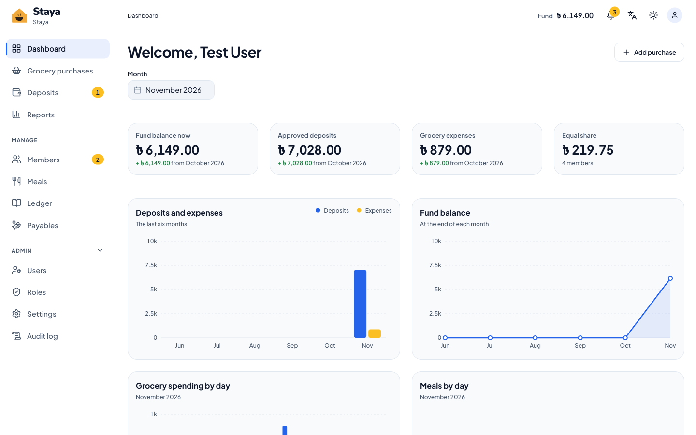
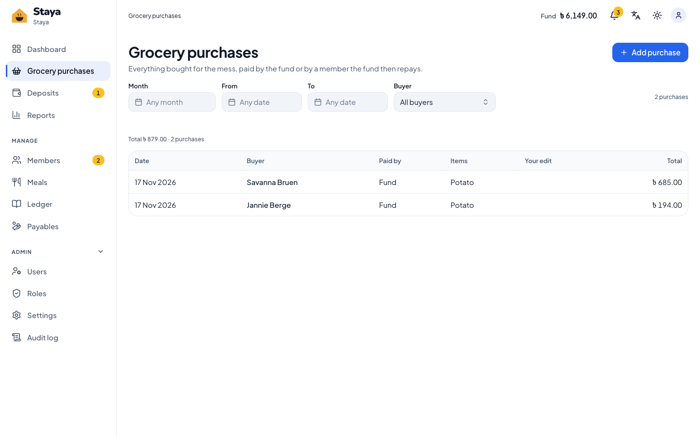
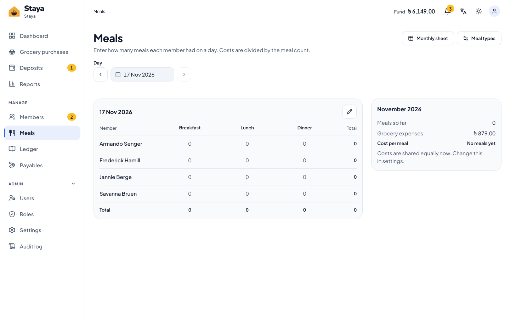
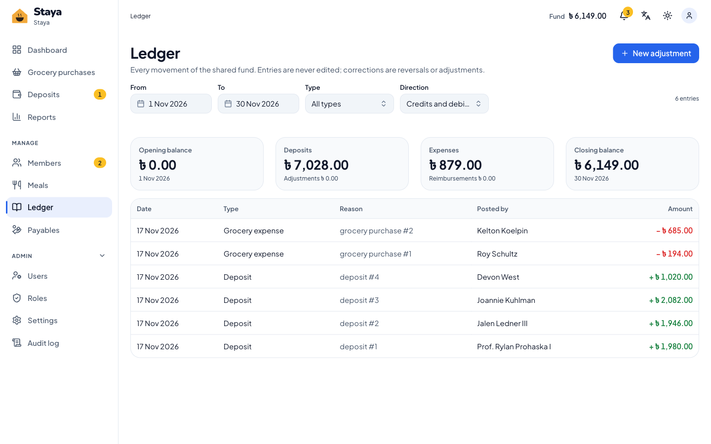
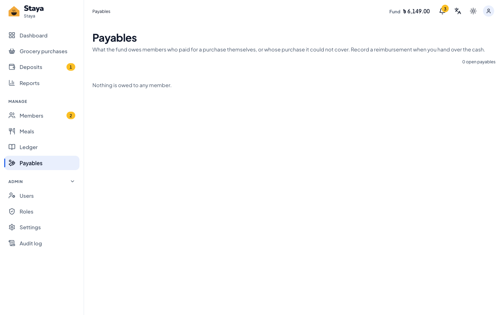
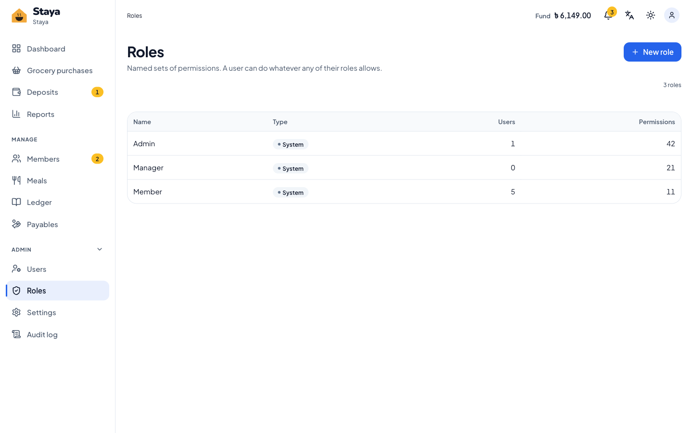
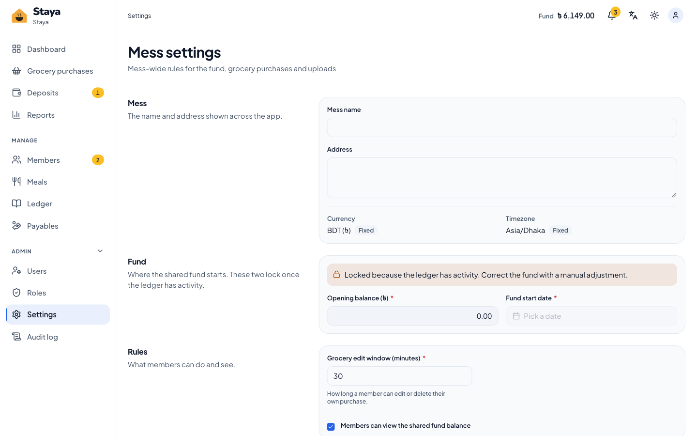
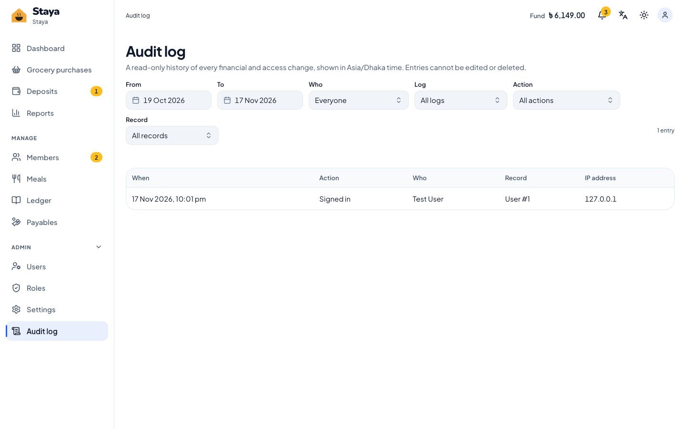

# Staya

Staya is a mess management system for shared houses and hostels. It keeps member profiles, daily grocery purchases, member deposits, meals and one shared mess fund in a single place, and records every taka in an auditable ledger so members and managers can see exactly where the money went.

- Amounts are in BDT (৳), stored as `DECIMAL(12,2)`, and calculated with bcmath. Floats are never used for money.
- Timestamps are stored in UTC and shown in Asia/Dhaka.
- The interface is available in English and Bangla.



## Contents

- [Features](#features)
- [Screenshots](#screenshots)
- [Tech stack](#tech-stack)
- [Development installation](#development-installation)
- [Everyday commands](#everyday-commands)
- [Project layout](#project-layout)
- [Documentation](#documentation)

## Features

### Shared fund and ledger

- One shared mess fund. Grocery purchases are paid from it and approved deposits add to it.
- The fund balance is always the sum of the ledger entries.
- The ledger is append-only. Entries are never edited or deleted; mistakes are corrected with a reversal or a manual adjustment that needs a reason.
- The fund never goes below ৳0. If a purchase costs more than the fund holds, the fund pays what it has and the rest becomes a payable owed to the buyer, which staff repay later.
- Every financial change and its ledger entries are saved in one database transaction.

### Grocery purchases

- A purchase has a date, a buyer, one or more line items (name, quantity, unit, unit price), notes and an optional receipt photo.
- Item names autocomplete from names used before. Line totals and the grand total are always computed on the server.
- Members can edit or void their own purchase within a configurable window (30 minutes by default); after that it shows as locked and only authorised staff can change it.
- Editing posts a reversal of the old amount and a new entry. "Delete" is a void with a reason and a ledger reversal, never a hard delete.

### Deposits

- Members submit deposits, which stay pending until a manager approves or rejects them. Pending and rejected deposits never touch the balance.
- Approval posts to the ledger exactly once, protected by a row lock and a status check.
- Members can cancel a pending deposit. Approved deposits can only be reversed, with a reason.
- Nobody can approve their own deposit unless they hold the dedicated permission, and self-approvals are flagged.

### Members and registration

- Members have English and Bangla names (including father and mother), contact details, NID number and copy, a profile photo and a banner.
- People can register themselves, and an admin approves or rejects the registration. Admins can also create members directly or send invitation links.
- Members can leave and rejoin; every stay is its own record. A member active on any day of a month pays one full share for it.
- NID numbers and copies are visible only with `member.view_nid`, are stored on a private disk and are served through an authorised download route.

### Meals

- Daily meal entry by meal type, a meal sheet and a personal "my meals" view.
- Meal types are managed in the app.

### Reports and month closing

- Monthly report with opening and closing fund balance, deposits, expenses, adjustments, reimbursements, the active member count, cost per meal and the equal share.
- A per-member table of approved deposits, share, and due or credit. Each month stands alone; nothing carries forward.
- Filter by month, custom date range or member, and print the report.
- Closing a month locks everything dated in it. It can be reopened with a reason, and both actions are audited.

### Access control

- Roles are named bundles of permissions, managed in the app. Admin, Manager and Member are seeded.
- Permissions are granular (`grocery.update_own`, `deposit.approve`, `member.view_nid`, …) and are enforced on the server through Laravel Policies. Hiding a button is never the protection.
- Nobody can grant a permission they do not hold, change their own roles, or remove the last Admin.
- Sign-in with email and password, plus two-factor authentication and passkeys (Laravel Fortify).

### Audit log

- Every financial create, edit, void, approval, rejection and adjustment, plus NID views, role and permission changes and settings changes, is recorded with actor, IP address and before/after values.
- The audit log is append-only and visible only with `audit.view`.

### Settings

- Mess name and address, opening balance and fund start date, the member edit window, whether members can see the fund balance, and the maximum upload size.
- An Admin-only "Erase data" action that wipes all deposits, purchases, payables, ledger entries, month closures and meals to start from zero. It needs a typed phrase, a reason and the actor's password, and it is audit-logged.

### Interface

- English and Bangla, switchable from the top bar. Bangla names are shown in Bangla mode, English names otherwise.
- Light and dark themes, one shared set of components, and the type scale in `docs/TYPOGRAPHY.md`.
- Forms use their own validation messages in the app's design instead of the browser's built-in bubbles.

## Screenshots

All screenshots use seeded demo data.

|                                                                             |                                                                                          |
| --------------------------------------------------------------------------- | ---------------------------------------------------------------------------------------- |
| <br>**Sign in**                       | <br>**Dashboard in Bangla** |
| <br>**Grocery purchases** | <br>**Deposits**                               |
| <br>**Members**                     | <br>**New member**                     |
| <br>**Meals**                           | <br>**Ledger**                                     |
| <br>**Monthly report**       | <br>**Payables**                               |
| <br>**Roles and permissions**           | <br>**Settings**                               |
| <br>**Audit log**               |                                                                                          |

## Tech stack

| Area                  | Technology                                                                |
| --------------------- | ------------------------------------------------------------------------- |
| Backend               | PHP 8.4, Laravel 13, Laravel Fortify (auth, 2FA, passkeys)                |
| Frontend              | React 19, TypeScript, Inertia v3, Tailwind CSS v4, Radix UI, lucide-react |
| Routing glue          | Laravel Wayfinder (typed route functions for the frontend)                |
| Build                 | Vite via `vite-plus` (`vp`)                                               |
| Roles and permissions | `spatie/laravel-permission`                                               |
| Audit log             | `spatie/laravel-activitylog`                                              |
| Quality               | PHPUnit 12, Larastan (PHPStan), Pint, `vp check`, `tsc`                   |
| Database              | SQLite for local development; MySQL or PostgreSQL in production           |

## Development installation

### Requirements

- PHP 8.4 with the usual Laravel extensions (`bcmath`, `ctype`, `fileinfo`, `mbstring`, `openssl`, `pdo_sqlite`, `tokenizer`, `xml`, `gd` or `imagick`)
- [Composer](https://getcomposer.org) 2
- Node.js 22 or newer and npm
- SQLite (included with PHP in most setups)

[Laravel Herd](https://herd.laravel.com) installs PHP, Composer and Node for you on macOS and Windows and serves the app at `https://staya.test` when the project lives in its sites folder. Herd is optional; `php artisan dev` works anywhere.

### Setup

```bash
# 1. Get the code
git clone <repository-url> staya
cd staya

# 2. PHP dependencies
composer install

# 3. Environment file and application key
cp .env.example .env
php artisan key:generate

# 4. Database (SQLite by default)
touch database/database.sqlite
php artisan migrate

# 5. Demo data: roles and permissions, mess settings, sample members, deposits and purchases
php artisan db:seed

# 6. Frontend dependencies and typed route helpers
npm install
php artisan wayfinder:generate --with-form
```

`composer setup` runs most of these steps in one go (install, `.env`, key, migrate, `npm install`, `npm run build`). You still need to run `php artisan db:seed` afterwards.

Edit `.env` if you need to. The defaults use SQLite, the `database` driver for sessions, cache and queues, and `APP_URL=http://localhost:8000`. If you use Herd, set `APP_URL` to your `.test` address.

### Run it

```bash
composer run dev
```

This starts the web server, the queue worker (invitation and notification emails are queued), the log viewer and Vite together. Open the `APP_URL` from your `.env`.

If you serve the app yourself (Herd, Valet, Nginx), run only the parts you need:

```bash
npm run dev                    # Vite with hot reload
php artisan queue:listen       # queue worker
```

If a frontend change does not show up, or you see "Unable to locate file in Vite manifest", run `npm run build` once.

### Sign in

The seeder creates an Admin:

| Email              | Password   |
| ------------------ | ---------- |
| `test@example.com` | `password` |

The seeded data is for development only. Do not run `db:seed` in production. To set up a real installation, run the migrations and then the `AccessControlSeeder` and `MessSettingsSeeder`, and create your first Admin user.

### Reset the demo database

```bash
php artisan migrate:fresh --seed
```

## Everyday commands

```bash
# Tests
php artisan test --compact                       # whole suite
php artisan test --compact --filter=testName     # one test
php artisan test --compact tests/Feature/SomeTest.php

# PHP formatting and static analysis
vendor/bin/pint --dirty --format agent           # fix style in changed files
composer types:check                             # PHPStan

# Frontend
npm run check                                    # lint and format check (vp check)
npm run check:fix                                # fix what can be fixed
npm run types:check                              # tsc --noEmit
npm run build                                    # production build

# Everything CI runs
composer ci:check
```

Wayfinder writes `resources/js/actions`, `resources/js/routes` and `resources/js/wayfinder`. They are generated and git-ignored, so never edit them by hand. Regenerate them after adding or changing a route:

```bash
php artisan wayfinder:generate --with-form
```

## Project layout

| Path                                    | Contents                                                                                                 |
| --------------------------------------- | -------------------------------------------------------------------------------------------------------- |
| `app/Models`                            | Eloquent models (`Member`, `GroceryPurchase`, `Deposit`, `LedgerEntry`, …)                               |
| `app/Http/Controllers`                  | Thin controllers, grouped by area                                                                        |
| `app/Http/Requests`                     | Form Requests for all validation                                                                         |
| `app/Actions`                           | Single-purpose classes that hold business logic (`Deposits/ApproveDeposit`, `Settings/ResetMessData`, …) |
| `app/Policies`                          | One policy per model; the only place authorisation lives                                                 |
| `app/Enums`                             | Backed enums (`DepositStatus`, `LedgerEntryType`, …)                                                     |
| `database/`                             | Migrations, factories and seeders                                                                        |
| `lang/`                                 | Bangla translations and validation messages                                                              |
| `resources/js/pages`                    | Inertia pages, grouped by area                                                                           |
| `resources/js/components`               | Shared components; `components/ui` holds the primitives                                                  |
| `routes/web.php`, `routes/settings.php` | Named routes                                                                                             |
| `tests/Feature`, `tests/Unit`           | PHPUnit tests, mostly feature tests                                                                      |

## Documentation

- [`docs/project-overview.md`](docs/project-overview.md): requirements, roles, permissions and business rules
- [`docs/database-schema.md`](docs/database-schema.md): tables and columns
- [`docs/design-system.md`](docs/design-system.md): colours, components and spacing
- [`docs/TYPOGRAPHY.md`](docs/TYPOGRAPHY.md): the type scale and fonts
- [`docs/layout.md`](docs/layout.md): page layout rules
- [`CLAUDE.md`](CLAUDE.md) and [`AGENTS.md`](AGENTS.md): conventions for contributors and coding agents

## License

MIT
