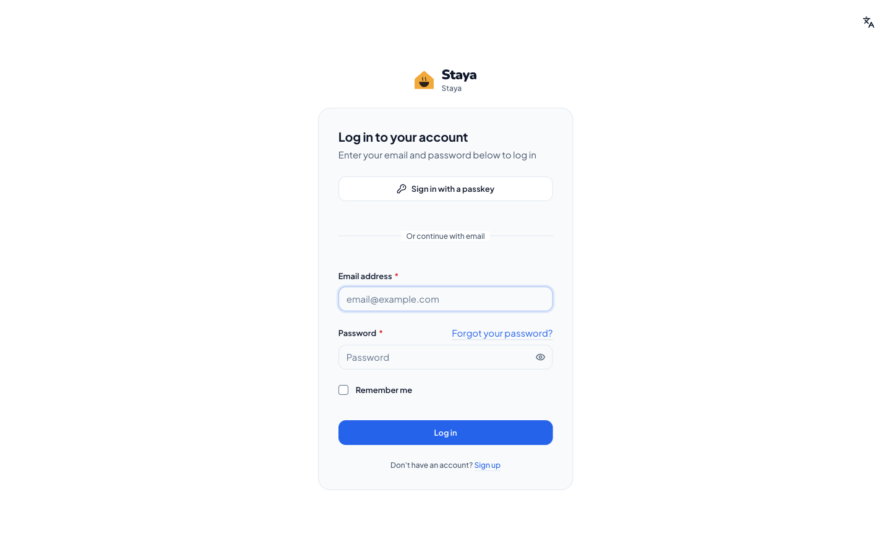
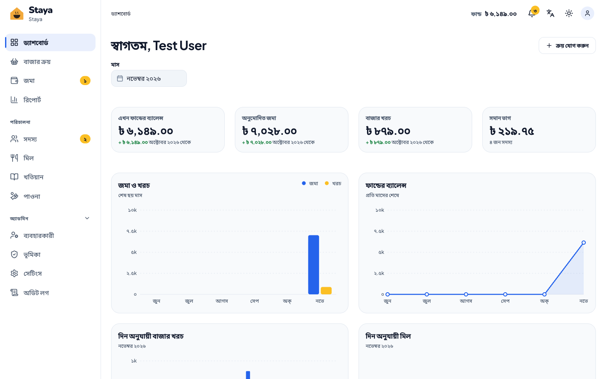
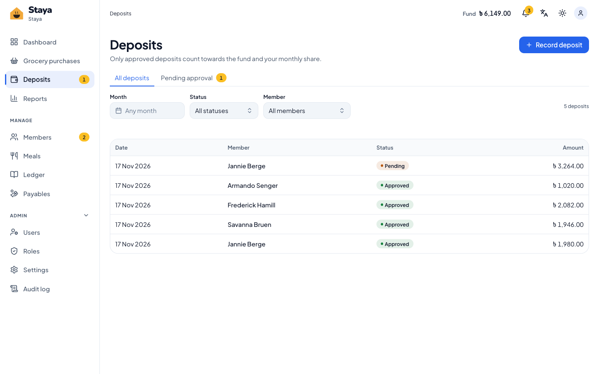
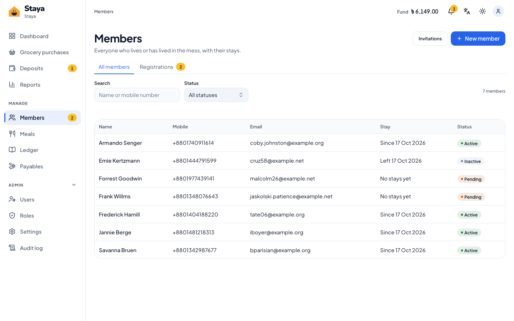
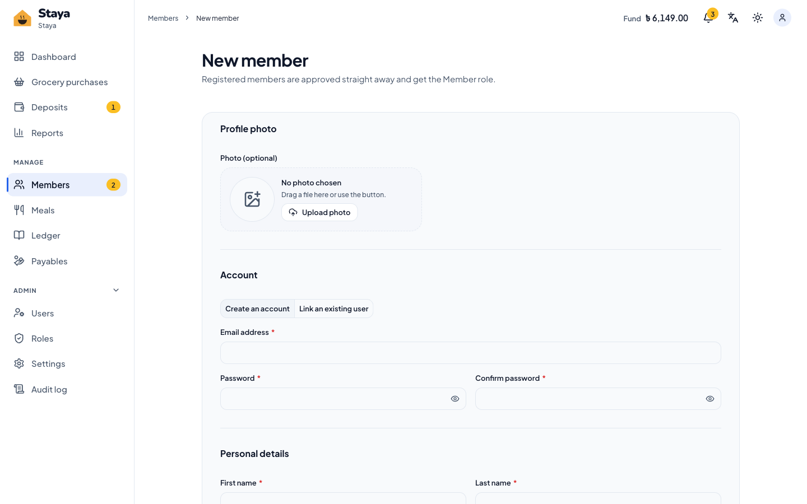
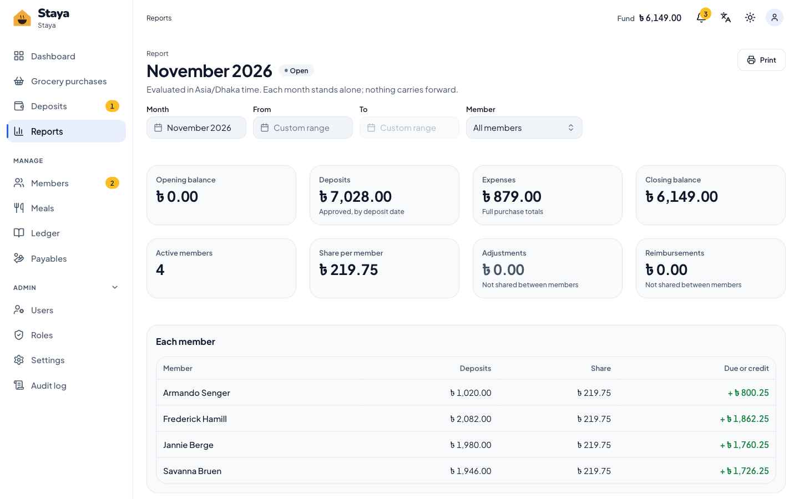

# Staya

Staya is a mess management system for shared houses and hostels. It keeps member profiles, daily grocery purchases, member deposits, meals and one shared mess fund in a single place, and records every taka in an auditable ledger so members and managers can see exactly where the money went.

- Amounts are in BDT (৳), stored as `DECIMAL(12,2)`, and calculated with bcmath. Floats are never used for money.
- Timestamps are stored in UTC and shown in Asia/Dhaka.
- The interface is available in English and Bangla.


## Contents

- [Features](#features)
- [Screenshots](#screenshots)
- [Tech stack](#tech-stack)
- [Development installation](#development-installation)
- [Everyday commands](#everyday-commands)
- [Deployment to cPanel](#deployment-to-cpanel)
- [Project layout](#project-layout)
- [Documentation](#documentation)

## Features

### Shared fund and ledger

- One shared mess fund. Grocery purchases are paid from it and approved deposits add to it.
- The fund balance is always the sum of the ledger entries.
- The ledger is append-only. Entries are never edited or deleted; mistakes are corrected with a reversal or a manual adjustment that needs a reason.
- The fund never goes below ৳0. If a purchase costs more than the fund holds, the fund pays what it has and the rest becomes a payable owed to the buyer, which staff repay later.
- Every financial change and its ledger entries are saved in one database transaction.

### Grocery purchases

- A purchase has a date, a buyer, one or more line items (name, quantity, unit, unit price), notes and an optional receipt photo.
- Item names autocomplete from names used before. Line totals and the grand total are always computed on the server.
- Members can edit or void their own purchase within a configurable window (30 minutes by default); after that it shows as locked and only authorised staff can change it.
- Editing posts a reversal of the old amount and a new entry. "Delete" is a void with a reason and a ledger reversal, never a hard delete.

### Deposits

- Members submit deposits, which stay pending until a manager approves or rejects them. Pending and rejected deposits never touch the balance.
- Approval posts to the ledger exactly once, protected by a row lock and a status check.
- Members can cancel a pending deposit. Approved deposits can only be reversed, with a reason.
- Nobody can approve their own deposit unless they hold the dedicated permission, and self-approvals are flagged.

### Members and registration

- Members have English and Bangla names (including father and mother), contact details, NID number and copy, a profile photo and a banner.
- People can register themselves, and an admin approves or rejects the registration. Admins can also create members directly or send invitation links.
- Members can leave and rejoin; every stay is its own record. A member active on any day of a month pays one full share for it.
- NID numbers and copies are visible only with `member.view_nid`, are stored on a private disk and are served through an authorised download route.

### Meals

- Daily meal entry by meal type, a meal sheet and a personal "my meals" view.
- Meal types are managed in the app.

### Reports and month closing

- Monthly report with opening and closing fund balance, deposits, expenses, adjustments, reimbursements, the active member count, cost per meal and the equal share.
- A per-member table of approved deposits, share, and due or credit. Each month stands alone; nothing carries forward.
- Filter by month, custom date range or member, and print the report.
- Closing a month locks everything dated in it. It can be reopened with a reason, and both actions are audited.

### Access control

- Roles are named bundles of permissions, managed in the app. Admin, Manager and Member are seeded.
- Permissions are granular (`grocery.update_own`, `deposit.approve`, `member.view_nid`, …) and are enforced on the server through Laravel Policies. Hiding a button is never the protection.
- Nobody can grant a permission they do not hold, change their own roles, or remove the last Admin.
- Sign-in with email and password, plus two-factor authentication and passkeys (Laravel Fortify).

### Audit log

- Every financial create, edit, void, approval, rejection and adjustment, plus NID views, role and permission changes and settings changes, is recorded with actor, IP address and before/after values.
- The audit log is append-only and visible only with `audit.view`.

### Settings

- Mess name and address, opening balance and fund start date, the member edit window, whether members can see the fund balance, and the maximum upload size.
- An Admin-only "Erase data" action that wipes all deposits, purchases, payables, ledger entries, month closures and meals to start from zero. It needs a typed phrase, a reason and the actor's password, and it is audit-logged.

### Interface

- English and Bangla, switchable from the top bar. Bangla names are shown in Bangla mode, English names otherwise.
- Light and dark themes, one shared set of components, and the type scale in `docs/TYPOGRAPHY.md`.
- Forms use their own validation messages in the app's design instead of the browser's built-in bubbles.

## Screenshots

All screenshots use seeded demo data.

|                                                                             |                                                                                          |
| --------------------------------------------------------------------------- | ---------------------------------------------------------------------------------------- |
| <br>**Sign in**                       | <br>**Dashboard in Bangla** |
| <br>**Grocery purchases** | <br>**Deposits**                               |
| <br>**Members**                     | <br>**New member**                     |
| <br>**Meals**                           | <br>**Ledger**                                     |
| <br>**Monthly report**       | <br>**Payables**                               |
| <br>**Roles and permissions**           | <br>**Settings**                               |
| <br>**Audit log**               |                                                                                          |

## Tech stack

| Area                  | Technology                                                                |
| --------------------- | ------------------------------------------------------------------------- |
| Backend               | PHP 8.4, Laravel 13, Laravel Fortify (auth, 2FA, passkeys)                |
| Frontend              | React 19, TypeScript, Inertia v3, Tailwind CSS v4, Radix UI, lucide-react |
| Routing glue          | Laravel Wayfinder (typed route functions for the frontend)                |
| Build                 | Vite via `vite-plus` (`vp`)                                               |
| Roles and permissions | `spatie/laravel-permission`                                               |
| Audit log             | `spatie/laravel-activitylog`                                              |
| Quality               | PHPUnit 12, Larastan (PHPStan), Pint, `vp check`, `tsc`                   |
| Database              | SQLite for local development; MySQL or PostgreSQL in production           |

## Development installation

### Requirements

- PHP 8.4 with the usual Laravel extensions (`bcmath`, `ctype`, `fileinfo`, `mbstring`, `openssl`, `pdo_sqlite`, `tokenizer`, `xml`, `gd` or `imagick`)
- [Composer](https://getcomposer.org) 2
- Node.js 22 or newer and npm
- SQLite (included with PHP in most setups)

[Laravel Herd](https://herd.laravel.com) installs PHP, Composer and Node for you on macOS and Windows and serves the app at `https://staya.test` when the project lives in its sites folder. Herd is optional; `php artisan dev` works anywhere.

### Setup

```bash
# 1. Get the code
git clone <repository-url> staya
cd staya

# 2. PHP dependencies
composer install

# 3. Environment file and application key
cp .env.example .env
php artisan key:generate

# 4. Database (SQLite by default)
touch database/database.sqlite
php artisan migrate

# 5. Demo data: roles and permissions, mess settings, sample members, deposits and purchases
php artisan db:seed

# 6. Frontend dependencies and typed route helpers
npm install
php artisan wayfinder:generate --with-form
```

`composer setup` runs most of these steps in one go (install, `.env`, key, migrate, `npm install`, `npm run build`). You still need to run `php artisan db:seed` afterwards.

Edit `.env` if you need to. The defaults use SQLite, the `database` driver for sessions, cache and queues, and `APP_URL=http://localhost:8000`. If you use Herd, set `APP_URL` to your `.test` address.

### Run it

```bash
composer run dev
```

This starts the web server, the queue worker (invitation and notification emails are queued), the log viewer and Vite together. Open the `APP_URL` from your `.env`.

If you serve the app yourself (Herd, Valet, Nginx), run only the parts you need:

```bash
npm run dev                    # Vite with hot reload
php artisan queue:listen       # queue worker
```

If a frontend change does not show up, or you see "Unable to locate file in Vite manifest", run `npm run build` once.

### Sign in

The seeder creates an Admin:

| Email              | Password   |
| ------------------ | ---------- |
| `test@example.com` | `password` |

The seeded data is for development only. Do not run `db:seed` in production. To set up a real installation, run the migrations and then the `AccessControlSeeder` and `MessSettingsSeeder`, and create your first Admin user.

### Reset the demo database

```bash
php artisan migrate:fresh --seed
```

## Everyday commands

```bash
# Tests
php artisan test --compact                       # whole suite
php artisan test --compact --filter=testName     # one test
php artisan test --compact tests/Feature/SomeTest.php

# PHP formatting and static analysis
vendor/bin/pint --dirty --format agent           # fix style in changed files
composer types:check                             # PHPStan

# Frontend
npm run check                                    # lint and format check (vp check)
npm run check:fix                                # fix what can be fixed
npm run types:check                              # tsc --noEmit
npm run build                                    # production build

# Everything CI runs
composer ci:check
```

Wayfinder writes `resources/js/actions`, `resources/js/routes` and `resources/js/wayfinder`. They are generated and git-ignored, so never edit them by hand. Regenerate them after adding or changing a route:

```bash
php artisan wayfinder:generate --with-form
```

## Deployment to cPanel

Every push to `main` is deployed automatically by `.github/workflows/deploy.yml`. You can also run it by hand from the Actions tab (**deploy** → **Run workflow**).

The server never installs or compiles anything. GitHub Actions installs the production Composer dependencies, builds the frontend, and sends the result over SSH with `tar`, so the server needs nothing beyond SSH access (no `rsync`). `deploy/sync.sh` compares a checksum manifest with the one from the last deploy and uploads only the files whose content changed (and deletes the ones that were removed), so a normal deploy moves a few hundred KB and takes about a minute, most of it spent building in CI. Then `deploy/post-deploy.sh` runs on the server: maintenance mode on, `migrate --force`, rebuild the caches, restart the queue worker, maintenance mode off.

The server's `.env` is written from the `ENV_FILE` variable on every deploy (see GitHub setup). `storage/` (uploads, logs, sessions) is never touched.

### One-time server setup

1. **PHP 8.4.** In cPanel open **MultiPHP Manager** and set the domain to PHP 8.4. Enable `bcmath`, `mbstring`, `pdo_mysql`, `fileinfo`, `intl` and `gd` (or `imagick`) in **Select PHP Version → Extensions**.
2. **Database.** Create a MySQL database and user in **MySQL Databases** and give the user all privileges.
3. **SSH access.** Enable SSH for the account (**SSH Access**), then create a key pair for deploys on your own computer:

    ```bash
    ssh-keygen -t ed25519 -f staya-deploy -C "staya deploy" -N ""
    ```

    In cPanel go to **SSH Access → Import Key**, paste `staya-deploy.pub` as the public key, and **Authorize** it.

4. **App folder.** Pick a folder outside `public_html`, for example `/home/USER/staya`, and create it. In **Domains → Manage**, set the domain's **Document Root** to `/home/USER/staya/public`. If your host does not allow that, keep the app folder as is and replace `public_html` with a symlink to `/home/USER/staya/public`.
5. **Queue worker.** Invitation and notification emails are queued. In **Cron Jobs** add one job that runs every minute (use your PHP 8.4 path from step 6):

    ```cron
    * * * * * cd /home/USER/staya && /opt/cpanel/ea-php84/root/usr/bin/php artisan queue:work --stop-when-empty --tries=1 --max-time=55 >> /dev/null 2>&1
    ```

6. **Find the PHP path.** Over SSH, `ls /opt/cpanel/ | grep ea-php84` confirms it. The usual path is `/opt/cpanel/ea-php84/root/usr/bin/php`.

### GitHub setup

In the repository go to **Settings → Environments → New environment** and create `production`. Add **required reviewers** there if you want a manual approval before each deploy. Then add these to that environment:

| Type     | Name              | Value                                                                                           |
| -------- | ----------------- | ----------------------------------------------------------------------------------------------- |
| Secret   | `SSH_HOST`        | Server hostname or IP                                                                           |
| Secret   | `SSH_USER`        | cPanel username                                                                                 |
| Secret   | `SSH_PORT`        | SSH port; leave out for 22 (many hosts use a custom one)                                        |
| Secret   | `SSH_PRIVATE_KEY` | Contents of `staya-deploy` (the private key)                                                    |
| Secret   | `SSH_KNOWN_HOSTS` | Output of `ssh-keyscan -p PORT HOST`                                                            |
| Secret   | `DEPLOY_PATH`     | `/home/USER/staya`                                                                              |
| Variable | `PHP_BIN`         | `/opt/cpanel/ea-php84/root/usr/bin/php` (the default `php` is often an older version on cPanel) |

`ENV_FILE` is copied to `.env` on the server at every deploy, so edit the variable and deploy to change a setting. Start from `.env.example`:

```dotenv
APP_NAME=Staya
APP_ENV=production
APP_DEBUG=false
APP_URL=https://your-domain.example
APP_KEY=base64:...   # run `php artisan key:generate --show` locally and paste the result

DB_CONNECTION=mysql
DB_HOST=localhost
DB_PORT=3306
DB_DATABASE=cpaneluser_staya
DB_USERNAME=cpaneluser_staya
DB_PASSWORD=...

SESSION_DRIVER=database
SESSION_SECURE_COOKIE=true
QUEUE_CONNECTION=database
CACHE_STORE=database

MAIL_MAILER=smtp   # then your cPanel mailbox settings
```

Variables, unlike secrets, can be read by anyone with write access to the repository, and the database password and `APP_KEY` are in this file. Keep the repository private and limit who can write to it. If `ENV_FILE` is empty, the deploy keeps whatever `.env` is already on the server. Never change `APP_KEY` after launch: it would invalidate the encrypted NID numbers and every session.

`SSH_KNOWN_HOSTS` pins the server's host key, so the deploy refuses to connect to anything else. Get it from a network you trust.

### First deploy

1. Run the **deploy** workflow once (or push to `main`). It uploads the code and runs the migrations.
2. Over SSH, load the roles and permissions and the default settings, and create the first Admin. These are not part of every deploy:

    ```bash
    cd /home/USER/staya
    PHP=/opt/cpanel/ea-php84/root/usr/bin/php
    $PHP artisan db:seed --class=AccessControlSeeder --force
    $PHP artisan db:seed --class=MessSettingsSeeder --force
    $PHP artisan tinker --execute '$u = App\Models\User::create(["name" => "Your name", "name_bn" => "আপনার নাম", "email" => "you@example.com", "password" => "a-long-password"]); $u->forceFill(["email_verified_at" => now()])->save(); $u->assignRole(App\Models\Role::admin());'
    ```

3. Sign in, change the password, and set the mess name, opening balance and fund start date in **Settings**.

Do not run `php artisan db:seed` without `--class` on the server; it creates demo data.

### Rolling back

Re-run the **deploy** workflow from the last good commit (**Run workflow**, choose that commit's branch or revert on `main`). Migrations are not rolled back automatically, so write them to be backwards compatible, or run `php artisan migrate:rollback --step=1 --force` over SSH before redeploying.

### If a deploy fails

- The deploy does not wait for the `tests` workflow; both start on every push. Check that `tests` is green, or protect `main` with a required status check, so a broken commit is not deployed.
- If `migrate` fails, the site stays in maintenance mode on purpose, because the new code is live but the database is not ready for it. Fix the cause, then run `bash deploy/post-deploy.sh` on the server (with `PHP_BIN` set) or re-run the workflow.
- `permission denied (publickey)`: the public key is not authorised in cPanel, or `SSH_PRIVATE_KEY` is missing its final newline or has extra characters.
- `Host key verification failed`: `SSH_KNOWN_HOSTS` was made for a different host or port.

## Project layout

| Path                                    | Contents                                                                                                 |
| --------------------------------------- | -------------------------------------------------------------------------------------------------------- |
| `app/Models`                            | Eloquent models (`Member`, `GroceryPurchase`, `Deposit`, `LedgerEntry`, …)                               |
| `app/Http/Controllers`                  | Thin controllers, grouped by area                                                                        |
| `app/Http/Requests`                     | Form Requests for all validation                                                                         |
| `app/Actions`                           | Single-purpose classes that hold business logic (`Deposits/ApproveDeposit`, `Settings/ResetMessData`, …) |
| `app/Policies`                          | One policy per model; the only place authorisation lives                                                 |
| `app/Enums`                             | Backed enums (`DepositStatus`, `LedgerEntryType`, …)                                                     |
| `database/`                             | Migrations, factories and seeders                                                                        |
| `lang/`                                 | Bangla translations and validation messages                                                              |
| `resources/js/pages`                    | Inertia pages, grouped by area                                                                           |
| `resources/js/components`               | Shared components; `components/ui` holds the primitives                                                  |
| `routes/web.php`, `routes/settings.php` | Named routes                                                                                             |
| `tests/Feature`, `tests/Unit`           | PHPUnit tests, mostly feature tests                                                                      |

## Documentation

- [`docs/project-overview.md`](docs/project-overview.md): requirements, roles, permissions and business rules
- [`docs/database-schema.md`](docs/database-schema.md): tables and columns
- [`docs/design-system.md`](docs/design-system.md): colours, components and spacing
- [`docs/TYPOGRAPHY.md`](docs/TYPOGRAPHY.md): the type scale and fonts
- [`docs/layout.md`](docs/layout.md): page layout rules
- [`CLAUDE.md`](CLAUDE.md) and [`AGENTS.md`](AGENTS.md): conventions for contributors and coding agents

## License

MIT
